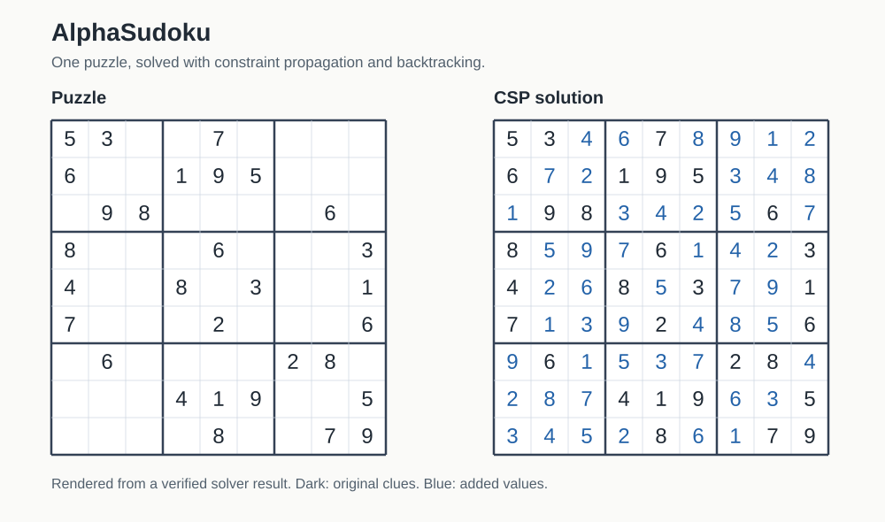

# AlphaSudoku
AlphaSudoku is a research project that compares and visualizes algorithms for solving Sudoku. While Sudoku is traditionally solved with backtracking, its familiar rules also make it a useful setting for exploring genetic search and simulated annealing. We combine these with other algorithms to compare deterministic and nondeterministic approaches. Some of these algorithms are:
* Backtracking
* Constraint Satisfaction
* AC-3
* Genetic search
* Simulated annealing



*A puzzle and its verified CSP solution, rendered from the solver's output rather than captured from the web interface. Original clues are dark; added values are blue.*

Our hope is that by applying these algorithms in a practical setting and visualizing the process, others will be able to better use them elsewhere.

### A Note on Tech
Though it is possible to use any language to implement, analyze, and visualize these algorithms, we found Python to be the most suited to our needs. Additionally, we use Flask, a lightweight web framework to help visualize the algorithms.

### Further Exploration
While we accomplished our initial goal of comparing a standard algorithm against a few non-standard ones, there are plenty of new ways to solve Sudoku. Some of these algorithms are:
- A*
- Hill climbing
- Iterative deepening
- Uniform-cost search

These approaches have different costs and tradeoffs. Probabilistic methods such as simulated annealing can help a search move away from a local minimum. We discuss the approaches used in this project further in our paper.
### Paper
Our research mostly discusses the differences between traditional solutions and our main alternative algorithm, genetic search, but there is also discussion of other algorithms and how they compare.
[Comparison of Non-Deterministic Sudoku Algorithms](comparison_of_nondeterministic_algorithms.pdf)
## Installation
Use Python 3.10 or newer. The constraint solver and Flask page were checked with Python 3.12.

```sh
git clone https://github.com/TheDeafOne/AlphaSudoku.git
cd AlphaSudoku
python -m venv .venv
```

Activate the environment with `source .venv/bin/activate` on macOS/Linux, or `.venv\Scripts\Activate.ps1` in Windows PowerShell. Then install and run:

```sh
python -m pip install -r requirements.txt
python app.py
```

Open [http://127.0.0.1:5000](http://127.0.0.1:5000). Run from the repository root so the board-index files in `data/board_indexes` can be found.

## Using the Project
Enter the puzzle's clues using 1–9 and leave empty cells as 0. Choose **Genetic** or **Backtracking**, select **Submit Board**, then **Run Board**. The Genetic option uses the hybrid solver; Backtracking uses constraint propagation and search.

The logic of the project can generally be broken down into three parts:
1. Board Logic
2. Algorithms
3. Visualization

Board logic and algorithms can be found in [board_logic](board_logic) and [algorithms](algorithms). Visualization is done through Flask, with most of that logic in [app.py](app.py), [templates](templates), and [static](static). The board and solver classes can also be used directly from Python.
